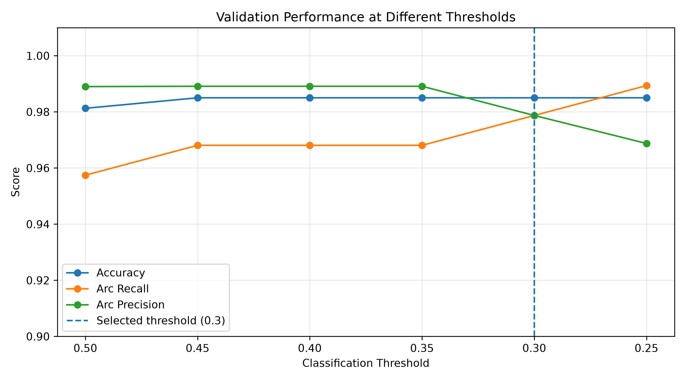
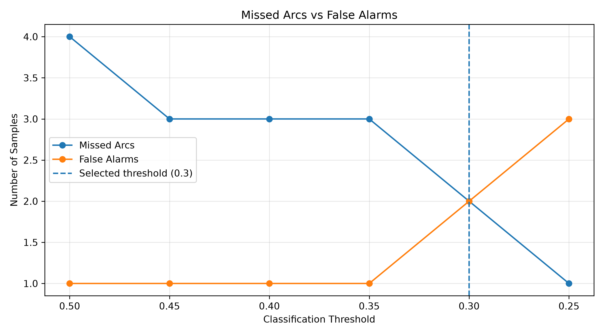
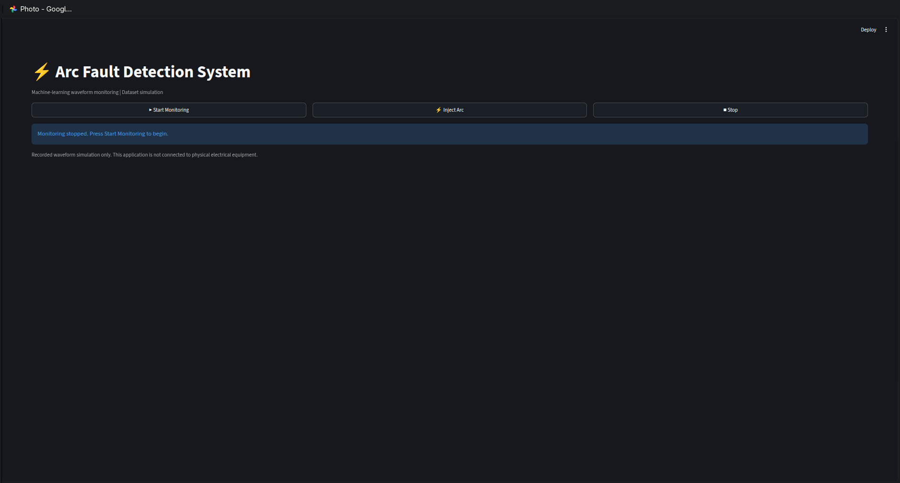
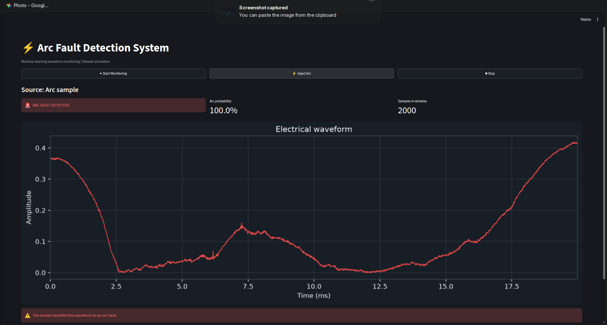
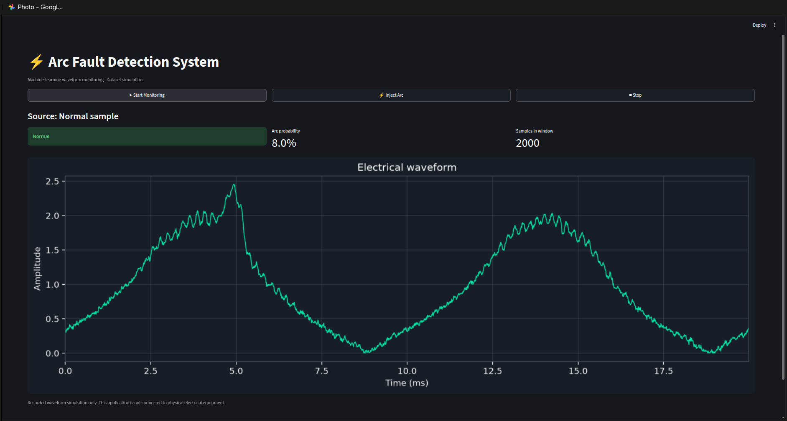

# ⚡ ML-Based Arc Fault Detection

A machine learning project that uses signal processing and a Random Forest classifier to distinguish normal electrical waveforms from arc fault waveforms.

## 🎯 Objective

Explore how machine learning can identify arc faults from electrical signals by learning statistical and frequency-domain patterns.

## 🔬 Workflow

1. **Data Exploration** — examine waveform samples and class distributions.
2. **Feature Extraction** — calculate signal characteristics.
3. **Model Training** — train a Random Forest classifier.
4. **Evaluation** — investigate feature importance and classification thresholds.
5. **Visualization** — display waveforms and model results through a Streamlit dashboard.

## 📊 Dataset

This project uses the Residential Series Arc Fault Dataset obtained from Zenodo.

- Sampling frequency: 100 kHz
- Window duration: 20 ms
- Samples per waveform: 2,000
- Labels: `0` = Normal, `1` = Arc Fault

See [`data/DATASET.md`](data/DATASET.md) for dataset information. The raw dataset and generated CSV files are not included in the repository.

## 🧪 Feature Extraction

The model uses 12 time-domain and frequency-domain features:

- Mean, variance, RMS, peak, and peak-to-peak amplitude
- Crest factor, kurtosis, and skewness
- FFT energy and dominant frequency
- Spectral centroid and high-frequency energy

## 🤖 Model and Threshold Experiments

A Random Forest classifier is trained using the extracted features. Validation experiments compare accuracy, arc recall, arc precision, missed arcs, and false alarms at different classification thresholds.

### Validation Performance



### Missed Arcs vs False Alarms



The current candidate uses all 12 features with a threshold of `0.30`. On the validation split, it achieved approximately **98.50% accuracy**, **97.87% arc recall**, and **97.87% arc precision**, with 2 missed arcs and 2 false alarms.

These are validation results, not a guarantee of real-world detection performance.

## 🖥️ Streamlit Dashboard

The dashboard demonstrates detection using recorded dataset waveforms.

- **Start Monitoring** — cycle through normal waveform samples.
- **Inject Arc** — display an arc sample and run the prediction pipeline.
- **Stop** — pause the simulation.
- View the waveform, arc probability, and model prediction.

This is a dataset-driven software simulation, not a live electrical monitoring system.

## 🛠️ Technologies

Python, NumPy, Pandas, SciPy, Matplotlib, scikit-learn, Jupyter Notebook, Streamlit, and Joblib.

## 🚀 Setup and Usage

Create and activate a virtual environment, then install the dependencies:

```bash
python -m venv .venv
```

Linux / macOS:

```bash
source .venv/bin/activate
pip install -r requirements.txt
```

Windows PowerShell:

```powershell
.venv\Scripts\Activate.ps1
pip install -r requirements.txt
```

> **Note:** the scripts inside `.venv` store absolute paths. If you move or
> rename the project folder after creating the environment, recreate it
> (`python -m venv .venv` and reinstall), otherwise commands such as
> `streamlit` or `jupyter` fail with a "bad interpreter" error.

Obtain the dataset as described in [`data/DATASET.md`](data/DATASET.md), and place the required files in `data/`.

Generate the project data files by running the notebooks **in order**. Notebook 01
writes `data/train.csv` / `data/test.csv` (the raw waveforms the dashboard reads),
notebook 02 writes the feature tables, and notebook 03 retrains the model (a
pre-trained model is already committed, so retraining is optional):

```bash
jupyter nbconvert --to notebook --execute --inplace notebooks/01_data_exploration.ipynb
jupyter nbconvert --to notebook --execute --inplace notebooks/02_feature_extraction.ipynb
jupyter nbconvert --to notebook --execute --inplace notebooks/03_training.ipynb
```

(Opening them in Jupyter and using **Run All** works too. Only run one notebook
at a time, from top to bottom.)

Launch the dashboard from the project root:

```bash
streamlit run app.py
```

## 📁 Project Structure

```text
arc fault project/
├── data/
│   ├── DATASET.md
│   ├── arc_fault_model.joblib
│   ├── threshold_performance.png
│   └── threshold_tradeoff.png
├── notebooks/
│   ├── 01_data_exploration.ipynb
│   ├── 02_feature_extraction.ipynb
│   └── 03_training.ipynb
├── app.py
├── pipeline.py
├── README.md
├── requirements.txt
└── .gitignore
```

The dataset and generated CSV files are stored locally and excluded from version control.

## References

The project was developed with reference to the following research article and dataset:

1. **Research article:** [AIMS Press — Mathematical Biosciences and Engineering (2023)](https://www.aimspress.com/article/doi/10.3934/mbe.2023552)  
   DOI: [10.3934/mbe.2023552](https://doi.org/10.3934/mbe.2023552)

2. **Dataset:** [Real-time Series Arc Fault Detection and Appliances Classification in AC Networks Based on Competing Convolutional Kernels — Zenodo](https://zenodo.org/records/15279701)  
   DOI: [10.5281/zenodo.15279701](https://doi.org/10.5281/zenodo.15279701)

The publicly available dataset was used to explore arc fault detection using signal feature extraction and a Random Forest classifier. The implementation is an independent exploration of a machine-learning approach and does not reproduce the original paper's model or reported results.

## ⚠️ Disclaimer

This project is an educational machine-learning demonstration using recorded waveforms. It is not validated for safety-critical electrical protection or real-world deployment.


## 🖥️ Application Screenshots

### Application Interface


### Arc Fault Detection


### Normal Waveform Monitoring


